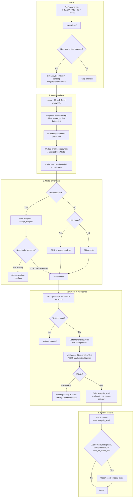

# Sentiment analysis flow — when a new post arrives

Live path: `backend/src/services/media_post_analysis` (started from `backend/src/index.js`).  
The older `sentimentanalysis` package is **not** the live scheduler.

---

## Flowchart

---

## Step summary

| Step | What happens | Key files |
|------|----------------|-----------|
| 1. Ingest | Monitor upserts post; new/changed text → `pending` + `nudgeTenant` | `monitoringsocialmedia/upsertPost.js`, event scan |
| 2. Queue | Nudge (~50ms) or poll (30s) loads oldest pending/failed into fair queue | `media_post_analysis/pollPending.js`, `queue.js`, `analysisFairQueue.js` |
| 3. Media | Video analysis and/or OCR; video also waits for audio transcript | `extractOcr.js`, `extractAudio.js`, `analyzeMediaPost.js` |
| 4. Sentiment | Keywords + policy pre-map → Sentiment API | `intelligence.client.service.js`, `mapping.service.js` |
| 5. Persist | Save `analysis_result`; alert if medium/high, keywords, or every-post setting | `analyzeMediaPost.js`, `alerts/alert.service.js` |

---

## Status values

| `analysis_status` | Meaning |
|-------------------|---------|
| `pending` | Waiting (new, retry, or audio still waiting) |
| `processing` | Worker claimed the row |
| `done` | Analysis saved |
| `skipped` | Empty / too-short text |
| `failed` | Gave up after max attempts (non-busy errors) |

---

## Env knobs (defaults)

| Variable | Default | Role |
|----------|---------|------|
| `MEDIA_ANALYSIS_POLL_MS` | `30000` | Poller interval |
| `MEDIA_ANALYSIS_POLL_BATCH` | `20` | Max jobs claimed per tenant per poll |
| `MEDIA_ANALYSIS_CONCURRENCY` | `2` | Parallel workers |
| `SENTIMENT_MAX_ATTEMPTS` | `5` | Max non-busy failures before `failed` |
| `OCR_SERVICE_URL` | `http://101.53.140.97:8000` | OCR / video extract base |
| `AUDIO_TRANSCRIBER_URL` | `http://127.0.0.1:2002` | Whisper-style transcription |
| `INTELLIGENCE_SERVICE_URL` / `CUSTOM_SENTIMENT_URL` | `http://127.0.0.1:8003` | Sentiment / intelligence API |

See also root [`pipeline.md`](../pipeline.md) for the fuller architecture write-up.
