# Media & Sentiment Analysis Pipeline Architecture

End-to-end processing for catalog posts (`social_media_posts`) and event media (`social_media_event_media`) in Blurasaga.

**Live scheduler:** `backend/src/services/media_post_analysis` (started from `backend/src/index.js`).  
`backend/src/services/sentimentanalysis` is a text-only sibling and is **not** started as the live poller.

For a focused “new post arrives” diagram, see [`docs/SENTIMENT_PIPELINE_FLOW.md`](docs/SENTIMENT_PIPELINE_FLOW.md).

---

## 1. High-Level Flowchart

```mermaid
flowchart TD
    classDef server fill:#1e293b,stroke:#3b82f6,stroke-width:2px,color:#fff;
    classDef gpu fill:#14532d,stroke:#22c55e,stroke-width:2px,color:#fff;
    classDef db fill:#312e81,stroke:#6366f1,stroke-width:2px,color:#fff;
    classDef ai fill:#701a75,stroke:#d946ef,stroke-width:2px,color:#fff;
    classDef step fill:#0f172a,stroke:#64748b,stroke-width:1px,color:#e2e8f0;

    subgraph INGEST["0. Ingest (monitors / event scan)"]
        A0["upsertPost / event media upsert"]:::server
        A1["analysis_status = pending"]:::step
        A2["nudgeTenant(dbName) ~50ms"]:::server
        A0 --> A1 --> A2
    end

    subgraph INGESTION["1. Poller & Job Dispatcher"]
        A["pollPending.js<br/>every MEDIA_ANALYSIS_POLL_MS (default 30s)"]:::server
        B{"Pending / failed rows<br/>(attempts &lt; max)?"}:::step
        C["Fair in-memory queue (queue.js)<br/>oldest posted_at first<br/>concurrency default 2"]:::server
        A2 --> A
        A --> B
        B -- Yes --> C
    end

    subgraph MEDIA_PIPELINE["2. Media enrichment (per job)"]
        D{"Video URL?"}:::step
        E["extractVideo → image_analysis"]:::gpu
        F{"Image media?"}:::step
        G["extractOcr<br/>OCR_SERVICE_URL/extract"]:::gpu
        H["Optional audio transcript<br/>AUDIO_TRANSCRIBER_URL"]:::gpu
        I["Skip media enrichment"]:::step
        J["Combine: post text + media text + transcript"]:::step

        C --> D
        D -- Yes --> E --> H
        D -- No --> F
        F -- Yes --> G --> J
        F -- No --> I --> J
        H -- "still waiting" --> RETRY["status = pending (retry)"]:::step
        H -- "done / permanent fail" --> J
    end

    subgraph PRE_SENTIMENT["3. Pre-mapping & enrichment"]
        L["Match tenant keywords<br/>(keywords table, substring)"]:::step
        M["Infer category + resolve policies<br/>(mapping.service.js)"]:::step
        N["Resolve tenant_name from dbName"]:::step

        J --> L --> M --> N
    end

    subgraph SENTIMENT_API["4. Intelligence & sentiment"]
        O["intelligenceClient.analyzeText(lane: bulk)"]:::ai
        P["POST /analyze/intelligence<br/>texts + image_analysis + keywords + policy"]:::ai
        Q["Sentiment API<br/>(INTELLIGENCE_SERVICE_URL)"]:::ai
        R["Result: sentiment, risk_score,<br/>stance, category, intent, …"]:::step

        N --> O --> P --> Q --> R
    end

    subgraph PERSISTENCE["5. Result storage & alerts"]
        S["Score risk_level vs high/medium thresholds"]:::step
        T{"Alert? medium/high,<br/>keyword match, or alert_for_every_post"}:::step
        U["Upsert social_media_alerts"]:::step
        V["Update post / event_media:<br/>analysis_status = done<br/>analysis_result + image_analysis<br/>analyzed_at"]:::db

        R --> S --> T
        T -- Yes --> U --> V
        T -- No --> V
    end
```



---

## 2. Detailed Pipeline Steps

### Step 0: Ingest trigger
* **Components**: platform monitors → `monitoringsocialmedia/upsertPost.js`; event scans → `modules/events/event.scan.service.js`
* **Behavior**:
  * New catalog posts are inserted with `analysis_status: 'pending'`.
  * Existing posts are re-queued when text changes (status reset to `pending`) or when still `pending`/`failed`.
  * Ingest calls `nudgeTenant(dbName)` instead of enqueueing the new id directly, so a just-fetched post cannot jump ahead of older pending rows already in the DB.

### Step 1: Scheduling & queue dispatch
* **Components**: `media_post_analysis/pollPending.js`, `queue.js`, `analysisFairQueue.js`
* **Schedule**: interval poll (`MEDIA_ANALYSIS_POLL_MS`, default 30s) plus immediate nudge (~50ms) after ingest.
* **Claim order**: per tenant, oldest `posted_at` first (nulls last), batch size `MEDIA_ANALYSIS_POLL_BATCH` (default 20).
* **Concurrency**: in-memory fair queue, default `MEDIA_ANALYSIS_CONCURRENCY=2`, max queue `MEDIA_ANALYSIS_MAX_QUEUE` (default 1000).
* **Processor**: `kind: 'event'` → `analyzeEventMedia`; otherwise → `analyzeMediaPost`.

### Step 2: Media enrichment
* **Components**: `extractOcr.js`, `extractAudio.js`, `analyzeMediaPost.js` / `analyzeEventMedia.js`
* **OCR / video**: `OCR_SERVICE_URL` (fallback `http://101.53.140.97:8000`) — `POST /extract` for images and videos.
* **Audio**: for video posts, `AUDIO_TRANSCRIBER_URL` (default `http://127.0.0.1:2002`) — waits before sentiment; transient wait returns status to `pending` for retry.
* **Persistence**: full media payload is stored in `image_analysis`. Original `post.text` is not overwritten with OCR/transcript text; those are combined only for the analysis call.

### Step 3: Keywords & policy resolution
* **Components**: `analyzeMediaPost.js` / `analyzeEventMedia.js`, `modules/settings/mapping.service.js`
* **Keywords**: tenant `keywords` table; case-insensitive substring match on the combined analysis text (not token splitting).
* **Policies**: mapping service merges default / platform / legal rules and tenant overrides; category is inferred from text before the API call, then re-resolved using the ML category after a successful response.
* **Tenant name**: resolved from job `dbName` and passed to the intelligence client for stance (best-effort; lookup failure does not block sentiment).

### Step 4: Sentiment & intelligence call
* **Component**: `modules/intelligence/intelligence.client.service.js`
* **Target**: `INTELLIGENCE_SERVICE_URL` or legacy `CUSTOM_SENTIMENT_URL` (default `http://127.0.0.1:8003`)
* **Endpoint**: `POST /analyze/intelligence` with lane `bulk`
* **Typical payload fields**:
```json
{
  "texts": ["post text + media/OCR text + transcript…"],
  "image_analysis": { "full_text": "...", "bounding_boxes": [], "language": "en" },
  "keywords": [{ "keyword": "...", "weight": 50, "category": "other" }],
  "policy": {
    "category_id": "Defamation",
    "platform_policies": [],
    "legal_sections": []
  }
}
```
* **Failures**: HTTP/busy/backpressure → stay `pending` (busy does not burn attempts); other errors retry until `SENTIMENT_MAX_ATTEMPTS` (default 5) then `failed`. Empty combined text → `skipped`.

### Step 5: Persistence & alerts
* **Tables**: `social_media_posts` / `social_media_event_media`, `social_media_alerts`
* **On success**: `analysis_status: 'done'`, `analysis_result` (sentiment, confidence, risk_score/level, stance, category, keywords, policies, …), `image_analysis`, `analyzed_at`.
* **Alerts** (`createAlertFromCatalogPost`): created when risk is `medium`/`high`, **or** matched keywords exist, **or** tenant setting `alert_for_every_post` is true. Low risk with no keywords is skipped unless that setting is on.

---

## 3. Key env defaults

| Variable | Default | Purpose |
|----------|---------|---------|
| `MEDIA_ANALYSIS_POLL_MS` | `30000` | Poller interval |
| `MEDIA_ANALYSIS_POLL_BATCH` | `20` | Jobs per tenant per poll |
| `MEDIA_ANALYSIS_CONCURRENCY` | `2` | Parallel workers |
| `MEDIA_ANALYSIS_MAX_QUEUE` | `1000` | In-memory queue cap |
| `SENTIMENT_MAX_ATTEMPTS` | `5` | Max non-busy failures |
| `OCR_SERVICE_URL` | `http://101.53.140.97:8000` | OCR / video extract |
| `AUDIO_TRANSCRIBER_URL` | `http://127.0.0.1:2002` | Audio transcription |
| `INTELLIGENCE_SERVICE_URL` | `http://127.0.0.1:8003` | Sentiment API |
